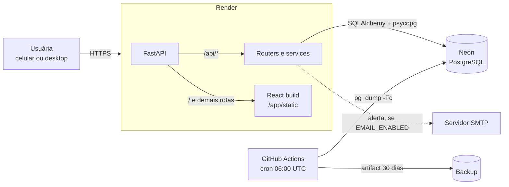
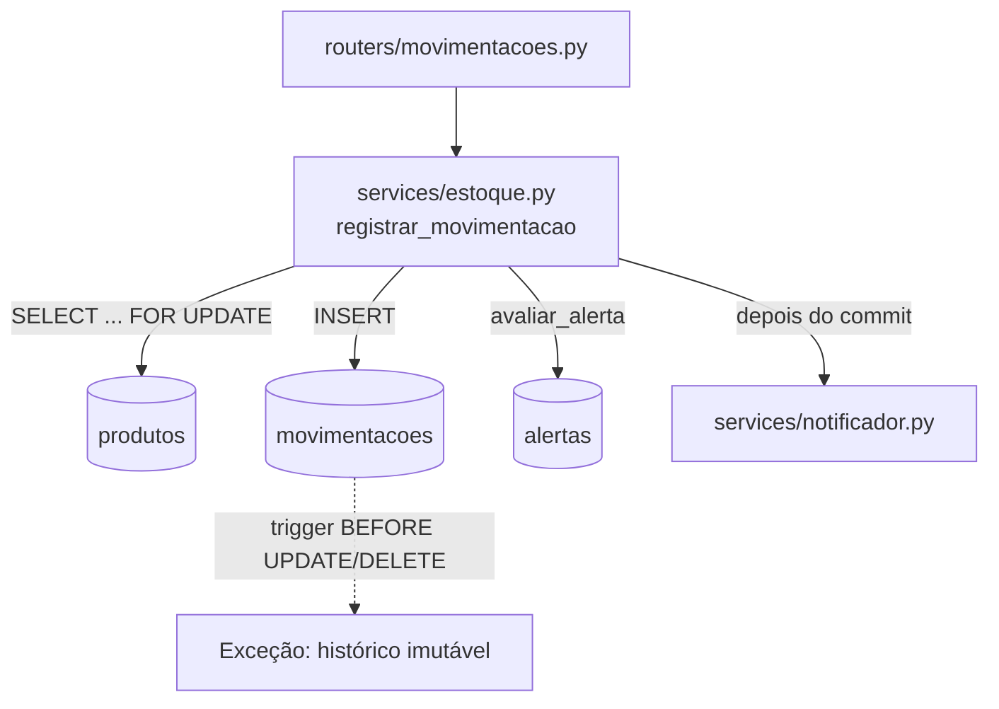

# EstoqueCerto

Sistema web de controle de estoque para oficina mecânica. Registra entradas, saídas e ajustes com motivo, calcula o saldo a partir do histórico, avisa quando um item precisa de reposição, aponta produtos parados e exporta relatórios em CSV para o Excel.

Pensado para uso no celular, com o balcão da oficina em mente: registrar uma saída leva no máximo três toques a partir do painel.

Documentação funcional (fonte de verdade): [`docs/documentacao-v3.txt`](docs/documentacao-v3.txt). Contrato técnico entre os módulos: [`SPEC.md`](SPEC.md). Design aprovado: [`docs/design/`](docs/design/).

## Stack

| Camada | Tecnologia |
|---|---|
| Front-end | React 18, TypeScript, Vite, react-router-dom 6, CSS próprio (sem biblioteca de UI) |
| Back-end | Python 3.12, FastAPI, SQLAlchemy 2 (sync), psycopg 3, Alembic, Pydantic 2 |
| Banco | PostgreSQL hospedado no Neon |
| Autenticação | E-mail e senha (bcrypt), token JWT HS256 de 7 dias no header `Authorization: Bearer` |
| E-mail | SMTP com STARTTLS, desligado por padrão |
| Hospedagem | Render, um único web service Docker |
| Backup | GitHub Actions (`pg_dump` diário) e PITR do Neon |

Um único serviço serve tudo: o FastAPI expõe a API em `/api` e entrega o build do React em `/`. Como front e API têm a mesma origem, não há CORS.

## Arquitetura



Dentro do back-end, as regras de negócio ficam em `services/`, e os routers apenas validam entrada e chamam os serviços:



## Como rodar localmente

Pré-requisitos: Python 3.12 (ou `uv`, que instala a versão certa), Node 22 e acesso a uma `DATABASE_URL` do Neon (use o branch de desenvolvimento).

### 1. Variáveis de ambiente

Crie `.env` na raiz do repositório a partir de `.env.example` e preencha `DATABASE_URL`, `JWT_SECRET` e `ADMIN_*`. O `.env` nunca é versionado. O back-end lê `../.env` (a partir de `backend/`) e também `backend/.env`.

### 2. Back-end com uv

```bash
cd backend
uv venv --python 3.12 .venv
uv pip install --python .venv/bin/python -r requirements.txt
.venv/bin/alembic upgrade head
.venv/bin/uvicorn app.main:app --reload --port 8000
```

A API fica em `http://localhost:8000/api` e a documentação interativa em `http://localhost:8000/api/docs`. Na primeira subida sem nenhum usuário, o sistema cria o usuário `ADMIN_EMAIL` com `ADMIN_PASSWORD`.

### 3. Front-end com npm

Em outro terminal:

```bash
cd frontend
npm install
npm run dev
```

O Vite sobe em `http://localhost:5173` e faz proxy de `/api` para `http://localhost:8000`. Para testar o build de produção: `npm run build` (gera `frontend/dist`).

### 4. Dados de demonstração

Cria categorias, produtos e movimentações de exemplo, incluindo o cenário do Apêndice B da documentação:

```bash
cd backend
.venv/bin/python -m app.cli seed-demo
```

## Testes

```bash
cd backend
.venv/bin/pytest -q
```

Os testes rodam contra o Postgres indicado em `TEST_DATABASE_URL` (ou `DATABASE_URL`). Cada sessão cria um schema temporário `test_<aleatório>`, aplica as migrações nele e o remove ao final. Os critérios de aceite estão na seção 14 da documentação.

## Variáveis de ambiente

| Variável | Padrão | Descrição |
|---|---|---|
| `DATABASE_URL` | obrigatória | URL `postgresql://` do Neon. O código troca o prefixo para `postgresql+psycopg://` e remove `channel_binding` |
| `JWT_SECRET` | obrigatória em produção | Chave de assinatura do token. Use um valor longo e aleatório |
| `JWT_EXPIRE_DAYS` | `7` | Validade do token |
| `ADMIN_EMAIL`, `ADMIN_PASSWORD`, `ADMIN_NOME` | — | Usuária criada no startup se o banco não tiver nenhum usuário |
| `EMAIL_ENABLED` | `false` | `true` liga o envio real dos alertas |
| `SMTP_HOST`, `SMTP_PORT`, `SMTP_USER`, `SMTP_PASSWORD`, `SMTP_FROM` | — | Servidor de saída (STARTTLS) |
| `ALERT_EMAIL_TO` | e-mail da usuária | Destinatário dos alertas |
| `APP_URL` | `http://localhost:8000` | Endereço público, usado no link dos e-mails |
| `STATIC_DIR` | `static` | Pasta com o build do React servido pelo FastAPI |
| `PORT` | `8000` | Porta do Uvicorn (o Render define sozinho) |

## Deploy no Render com o Neon

O deploy é feito pelo `Dockerfile` e pelo `render.yaml` (Blueprint). O serviço é Docker, plano free, região Ohio, com health check em `/api/health`.

1. **Neon.** Crie um projeto (ou use o existente) e copie a connection string do branch de produção (`main`), no formato `postgresql://...?sslmode=require`. Os branches `dev` e `main` ficam separados: produção usa só `main`.
2. **GitHub.** Envie o repositório para `1fahh/estoquecerto` (privado).
3. **Render.** Em *New > Blueprint*, selecione o repositório. O Render lê o `render.yaml` e pede os valores dos campos marcados como `sync: false`: `DATABASE_URL`, `JWT_SECRET`, `ADMIN_EMAIL`, `ADMIN_PASSWORD`, `ADMIN_NOME`, `APP_URL` e, se for usar e-mail, as variáveis `SMTP_*` e `ALERT_EMAIL_TO`.
4. **Primeiro deploy.** O container roda `alembic upgrade head` antes do Uvicorn, então o schema é criado ou atualizado automaticamente a cada deploy. Se a migração falhar, o deploy falha e o serviço antigo continua no ar.
5. **Conferir.** Abra `https://<seu-servico>.onrender.com/api/health`; a resposta esperada é `{"status":"ok","banco":"ok"}`.

Observações do plano free: o serviço dorme após um período sem acesso e a primeira requisição depois disso demora alguns segundos. O HTTPS e o certificado são fornecidos pelo Render.

Nas configurações do serviço, mantenha `APP_URL` igual à URL pública final, para que o link dos e-mails funcione.

## Backup e restauração (RNF07)

### Backup diário

O workflow `.github/workflows/backup.yml` roda todo dia às 06:00 UTC (03:00 em Brasília) e também pode ser disparado manualmente (*Actions > Backup do banco > Run workflow*). Ele instala o `postgresql-client-17` do repositório PGDG, executa `pg_dump --format=custom` usando o segredo `DATABASE_URL` do GitHub e publica o arquivo `estoquecerto-AAAA-MM-DD-HHMM.dump` como artifact, com retenção de 30 dias.

Para configurar: *Settings > Secrets and variables > Actions > New repository secret*, nome `DATABASE_URL`, valor igual ao do Render (branch de produção).

Baixe o artifact pela aba *Actions* da execução desejada. Guarde uma cópia fora do GitHub se precisar de retenção maior que 30 dias.

### Restaurar um dump

Em um banco vazio (ou em um branch novo do Neon, recomendado para conferir antes):

```bash
pg_restore --no-owner --no-acl --clean --if-exists \
  --dbname="$URL_DO_BANCO_DESTINO" estoquecerto-AAAA-MM-DD-HHMM.dump
```

`--clean --if-exists` apaga os objetos existentes antes de recriar. Use-o apenas no banco de destino certo. Para conferir, rode `psql "$URL_DO_BANCO_DESTINO" -c "select count(*) from movimentacoes;"` e compare com a produção.

### Point-in-time restore (Neon)

Além do backup em arquivo, o Neon mantém o histórico do branch e permite restaurar para um instante anterior, sem arquivo:

- Pelo console do Neon, use *Restore* no branch `main` e escolha a data e a hora desejadas. Isso cria um branch novo com o estado daquele momento.
- Para conferir sem afetar produção, crie um branch a partir de um ponto no tempo e aponte uma cópia local de `DATABASE_URL` para ele.
- A troca definitiva da produção para o branch restaurado é uma decisão manual; confirme os dados antes.

## Envio de e-mail de alerta

Os alertas de estoque baixo (RF09) são sempre exibidos no sistema. O envio por e-mail vem desligado (`EMAIL_ENABLED=false`): nesse modo o sistema só registra no log que o alerta seria enviado.

Para ligar:

1. Tenha uma conta SMTP com STARTTLS (por exemplo, o serviço de e-mail do domínio ou um provedor transacional). Se usar Gmail, é preciso uma senha de aplicativo.
2. No Render, preencha `SMTP_HOST`, `SMTP_PORT` (587), `SMTP_USER`, `SMTP_PASSWORD`, `SMTP_FROM` e `ALERT_EMAIL_TO`.
3. Troque `EMAIL_ENABLED` para `true` e salve. O Render reinicia o serviço.
4. Teste registrando uma saída que leve um produto abaixo do limite. O e-mail sai depois do commit; uma falha de envio nunca desfaz o registro da movimentação.

## Usuários pela linha de comando

Os comandos rodam dentro do container (ou localmente, a partir de `backend/`). No Render, abra *Shell* no serviço e execute:

```bash
python -m app.cli criar-usuario --email usuaria@exemplo.com.br --nome "Nome da Usuária"
python -m app.cli redefinir-senha --email usuaria@exemplo.com.br
python -m app.cli seed-demo
```

Se `--senha` for omitida, a senha é pedida de forma oculta e não aparece no histórico do shell. O sistema hoje é de uma usuária só (premissa 5a); criar outros usuários é possível, mas não há tela para isso.

## Relatórios CSV

Os arquivos seguem o padrão brasileiro: separador `;`, decimal com vírgula e BOM UTF-8, para abrir direto no Excel em pt-BR. Os tipos são `estoque`, `movimentacoes`, `parados`, `reposicao` e `quinzena`. Pela API: `GET /api/relatorios/exportar/{tipo}.csv`. O modelo para importação de produtos está em `GET /api/produtos/modelo-importacao.csv`.

## Estrutura do repositório

```
estoquecerto/
├── SPEC.md  README.md  Dockerfile  .dockerignore  render.yaml  .env.example
├── docs/                          documentação funcional, design e decisões
├── .github/workflows/backup.yml   backup diário (RNF07)
├── backend/
│   ├── requirements.txt           versões fixadas
│   ├── alembic/                   migrações (0001_inicial: tabelas, índices e trigger de imutabilidade)
│   ├── app/
│   │   ├── main.py                FastAPI, routers em /api, cabeçalhos de segurança, /api/health, build estático
│   │   ├── config.py              Settings (variáveis de ambiente)
│   │   ├── db.py  models.py  schemas.py  security.py
│   │   ├── services/              estoque.py, relatorios.py, csv_io.py, notificador.py
│   │   ├── routers/               auth, categorias, produtos, movimentacoes, alertas, relatorios, configuracoes
│   │   └── cli.py                 criar-usuario, redefinir-senha, seed-demo
│   └── tests/                     pytest (critérios de aceite da seção 14)
└── frontend/
    └── src/                       App.tsx (rotas), styles.css (tokens), api.ts, auth.tsx, pages/, components/
```

## Mapa requisito → implementação

### Requisitos funcionais

| Requisito | Descrição | Onde está |
|---|---|---|
| RF01 | Autenticar por e-mail e senha | `backend/app/routers/auth.py`, `backend/app/security.py` (bcrypt, JWT, limite de 10 tentativas/5 min por IP); `frontend/src/pages/Login.tsx`, `frontend/src/auth.tsx` |
| RF02 | Cadastrar, editar e inativar produtos | `backend/app/routers/produtos.py` (`POST`, `PUT`, `PATCH /ativo`, `DELETE`); `frontend/src/pages/Produtos.tsx`, `ProdutoForm.tsx` |
| RF03 | Cadastrar e editar categorias | `backend/app/routers/categorias.py`; chips de categoria em `ProdutoForm.tsx` |
| RF04 | Registrar entrada | `backend/app/routers/movimentacoes.py` (`/entrada`), `services/estoque.py`; `frontend/src/pages/Entrada.tsx` |
| RF05 | Registrar saída com motivo | `backend/app/routers/movimentacoes.py` (`/saida`), `services/estoque.py`; `frontend/src/pages/Saida.tsx` (painel de baixo) |
| RF06 | Ajuste de estoque com justificativa | `backend/app/routers/movimentacoes.py` (`/ajuste`), `services/estoque.py`; `frontend/src/pages/Ajuste.tsx` |
| RF07 | Consultar saldo por produto | `services/estoque.py` (saldo agregado em `GROUP BY`); campo `saldo` do `ProdutoOut`; `frontend/src/pages/Produtos.tsx` |
| RF08 | Estoque mínimo e percentual de alerta | Campos em `models.py` (`produtos`); `ProdutoForm.tsx`; padrão em `routers/configuracoes.py` |
| RF09 | Exibir e enviar alertas | `routers/alertas.py`, `services/estoque.py` (`avaliar_alerta`), `services/notificador.py`; `frontend/src/pages/Alertas.tsx`, `Painel.tsx` |
| RF10 | Histórico com filtros e saldo após cada registro | `routers/movimentacoes.py` (`GET /api/movimentacoes`, window function); `frontend/src/pages/Historico.tsx` |
| RF11 | Produtos parados e valor imobilizado | `services/relatorios.py`, `routers/relatorios.py` (`/parados`); `frontend/src/pages/Parados.tsx` |
| RF12 | Exportar CSV de estoque e movimentações | `services/csv_io.py`, `routers/relatorios.py` (`/exportar/{tipo}.csv`); `frontend/src/pages/Relatorios.tsx` |
| RF13 | Importar produtos por CSV | `services/csv_io.py`, `routers/produtos.py` (`POST /importar`, `GET /modelo-importacao.csv`); `frontend/src/pages/ImportarCsv.tsx` |

### Regras de negócio

| Regra | Descrição | Onde está |
|---|---|---|
| RN01 | Saldo derivado das movimentações | `services/estoque.py` (entradas − saídas ± ajustes). Não existe coluna de saldo |
| RN02 | Bloqueio de saldo negativo | `services/estoque.py` (`registrar_movimentacao`): saída ou ajuste acima do saldo retorna 422 |
| RN03 | Histórico imutável | Trigger `BEFORE UPDATE OR DELETE` em `alembic/versions/0001_inicial.py`; nenhuma rota de edição ou exclusão de movimentação |
| RN04 | Alerta quando saldo ≤ limite | `services/estoque.py` (`limite`, `em_alerta`) |
| RN05 | Percentual padrão de 20% por produto | `configuracoes.percentual_alerta_padrao` e `produtos.percentual_alerta` (`models.py`); `ProdutoForm.tsx` |
| RN06 | Um alerta ativo por produto | Índice único parcial `(produto_id) where situacao = 'ativo'` na migração; `avaliar_alerta` cria ou encerra |
| RN07 | Produtos parados (30 dias padrão) | `services/relatorios.py`; período em `configuracoes.periodo_parado_dias` |
| RN08 | Valor imobilizado = saldo × custo | `services/relatorios.py`; produtos sem custo ficam com `valor = null` |
| RN09 | Inativação em vez de exclusão | `routers/produtos.py` (`DELETE` retorna 409 se houver movimentações; `PATCH /ativo`); listas filtram `ativo=true` |
| RN10 | Movimentação e saldo na mesma transação | `services/estoque.py`: `SELECT ... FOR UPDATE`, insert, avaliação de alerta e commit único; e-mail só depois do commit |

### Requisitos não funcionais

| Requisito | Descrição | Onde está |
|---|---|---|
| RNF01 | Saída em até 3 interações a partir do painel | `frontend/src/pages/Saida.tsx` (chips de quantidade, motivo e botão em um único painel); `Painel.tsx` com botões Saída e Entrada |
| RNF02 | Consultas em até 2 s com 500 produtos | Consultas agregadas com `GROUP BY` e índices `(produto_id, data_hora desc)` e `(tipo, data_hora desc)`; teste de tempo em `backend/tests/` |
| RNF03 | Responsivo, celular e desktop | `frontend/src/styles.css` (`--app-max: 480px`, sem rolagem horizontal); `components/BottomNav.tsx` |
| RNF04 | Senhas com hash e HTTPS | bcrypt em `backend/app/security.py`; cabeçalhos de segurança (`Strict-Transport-Security`, `X-Frame-Options`, etc.) em `backend/app/main.py`; HTTPS pelo Render |
| RNF05 | Coleta mínima de dados (LGPD) | Apenas nome e e-mail da usuária em `usuarios`; sem dados de clientes |
| RNF06 | Código versionado e documentado | Repositório Git (GitHub); este README, `SPEC.md`, `docs/` |
| RNF07 | Backup diário | `.github/workflows/backup.yml` (pg_dump diário, retenção de 30 dias) e PITR do Neon |

## Licença e uso

Projeto privado para uso interno da oficina.
