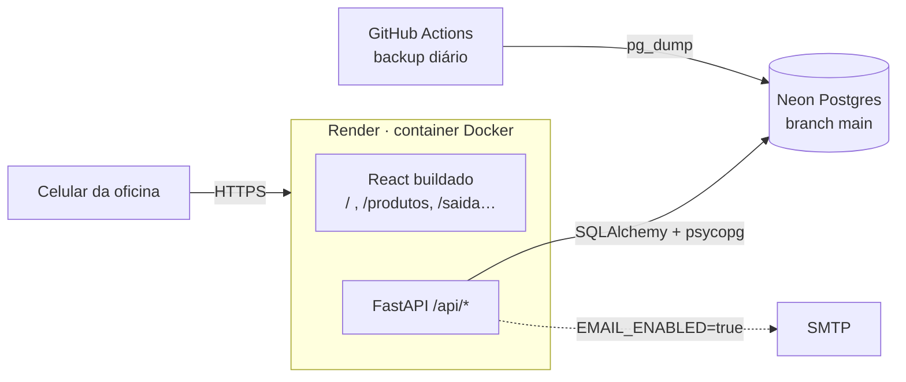
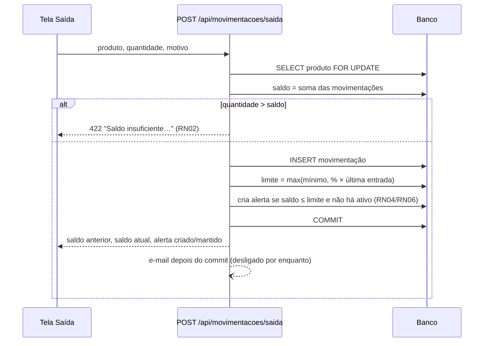

# Como o EstoqueCerto funciona

Guia curto para quem vai mexer no código. O contrato completo (tabelas, rotas, campos) está em `SPEC.md`; a regra de negócio original, em `docs/documentacao-v3.txt`.

## Arquitetura

Um único serviço no Render. O FastAPI responde a API em `/api` e entrega o build do React em todas as outras rotas. Com isso o site e a API ficam na mesma origem: não precisa de CORS e o HTTPS do Render protege os dois.

## A ideia central: o saldo nunca é digitado

Não existe coluna "saldo". O saldo de um produto é sempre **Σ entradas − Σ saídas + Σ ajustes** (RN01). Por isso o histórico precisa ser imutável: se um registro antigo pudesse mudar, o saldo de hoje mudaria em silêncio. As movimentações não têm rota de edição, e um *trigger* no banco recusa `UPDATE`/`DELETE` mesmo vindo de fora da API (RN03). Erro se corrige com um **ajuste com justificativa**.

## O que acontece numa saída

Tudo dentro de uma transação (RN10). O `FOR UPDATE` trava a linha do produto, então duas saídas simultâneas do mesmo item nunca enxergam o mesmo saldo.

## O alerta dos 20%

`limite = max(estoque_minimo, percentual_alerta% × quantidade da última entrada)`. Exemplo da documentação (Apêndice B): chegaram 100 L, então o limite é 20 L; com 18 L o produto entra em alerta. Cada produto tem no máximo **um** alerta ativo, garantido por um índice único parcial no banco. Uma entrada que leve o saldo acima do limite encerra o alerta; um novo só nasce se o saldo voltar a cair.

## Decisões que valem lembrar

| Decisão | Por quê |
|---|---|
| Quantidade `NUMERIC(12,3)` | óleo e fluido saem em litros fracionados |
| Último custo da entrada atualiza o produto | o valor parado (RN08) usa o custo mais recente |
| Produto com histórico só é inativado | apagar quebraria o histórico (RN09) |
| CSV com BOM, `;` e vírgula decimal | abre direto no Excel em português |
| Textos do CSV começando com `= + - @` ganham `'` | impede que um nome de produto vire fórmula na planilha |
| Limite de login: 10 falhas por IP; acima de 30 no mesmo e-mail, só IPs que já erraram são barrados; tentativa reservada na checagem | quem fica trocando de IP ganha 1 tentativa por IP; um atacante não tranca a dona da conta; tentativas simultâneas não furam o limite |
| `token_versao` no usuário | trocar a senha derruba as sessões abertas em outros aparelhos |
| E-mail de alerta desligado (`EMAIL_ENABLED=false`) | escolha atual; o alerta aparece no painel, e ligar o e-mail é só configurar o SMTP |

## Onde está cada coisa

- Regras de estoque e alertas: `backend/app/services/estoque.py`
- Parados, painel, valor imobilizado: `backend/app/services/relatorios.py`
- CSV: `backend/app/services/csv_io.py` (exportação) e `csv_importacao.py` (importação)
- Testes dos critérios de aceite (seção 14): `backend/tests/`
- Telas: `frontend/src/pages/` (design de referência em `docs/design/`)
