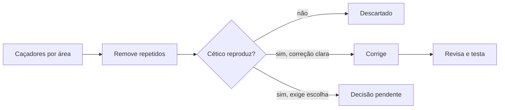

# Rodada de correção de bugs (26/11/2026)

Registro do que foi caçado, corrigido e do que ainda depende de decisão.

## Como foi feito

Um achado só vira correção depois que outro agente, tentando derrubá-lo, consegue reproduzi-lo.

## Padrões que se repetiram

| Padrão | Causa | Defesa |
|---|---|---|
| Erro 500 com número gigante, `NaN`, byte nulo | O schema aceitava o que o banco recusa | Validar na entrada com os mesmos limites das colunas (`schemas.py`) |
| Valor gravado errado sem aviso | Conversão "tolerante" de texto para número | Aceitar só formatos conhecidos e recusar o resto |
| Duas requisições passam na mesma checagem | `SELECT` antes do `INSERT` não protege contra concorrência | Tratar o erro do índice único (409) |
| Barra de baixo não ficava fixa | `overflow-x: hidden` quebra `position: sticky` | `overflow-x: clip` |
| Mensagem em inglês sem rede | `fetch` lança `TypeError` | Traduzir em um só lugar (`api.ts`) |

## Atenção no deploy

- `JWT_SECRET` agora precisa ter **32 caracteres ou mais**. Com menos, o app não sobe. Confira no Render antes de publicar; trocar o valor derruba as sessões abertas.
- `ADMIN_PASSWORD` precisa de 8 ou mais, apenas quando o banco ainda não tem usuário.

## Corrigidos

| # | Severidade | Problema |
|---|---|---|
| B1 | media | Campos numéricos sem teto estouram o Numeric do Postgres e viram 500 |
| B2 | media | Importação CSV inteira falha com 500 quando uma linha estoura o limite numérico |
| B3 | baixa | Ids fora da faixa do banco e datas-limite geram 500 |
| B4 | baixa | Texto com byte NUL ou surrogate derruba a API com 500 |
| B5 | baixa | PUT de produto e de configuração devolve percentual com 3 casas, mas o banco guarda 2 |
| B6 | alta | CSV com quebra de linha só CR (estilo Excel Mac antigo) dá 500 |
| B7 | media | NUL em texto ou campo de mais de 131072 caracteres dá 500 em vez de linha ignorada |
| B8 | media | Botão "Outra" selecionado: texto branco sobre azul claro (ilegível) |
| B9 | media | Arrastar a seleção de texto do campo "Outra" para fora da folha fecha a Saída e perde o que foi digitado |
| B10 | media | Custo unitário inválido na Entrada é gravado como vazio, sem aviso |
| B11 | alta | Limpar a data De ou Até em Relatórios derruba a tela inteira |
| B12 | media | Carregar mais após trocar o filtro mistura registros de filtros diferentes |
| B13 | baixa | Média de saída usa só as 500 saídas mais recentes do período |
| B14 | alta | Preferências: campo de percentual vazio é salvo como 0% |
| B15 | alta | Número em formato en-US é gravado com valor errado (custo 1,000.50 vira 1.0005 e depois R$ 1,00) |
| B16 | media | Erro de rede aparece para o usuário em inglês ('Failed to fetch') |
| B17 | baixa | Parser de números aceita hexadecimal e notação exponencial (parcial: falta a Saída/Entrada, ver pendências) |
| B18 | media | Nome de produto sem espaços estoura o cabeçalho de Entrada e Ajuste e fica cortado fora da tela |
| B19 | media | Campo 'Buscar produto' não mostra foco no celular (abaixo de 900px) |
| B20 | baixa | backend/.env entra no contexto do docker build |
| B21 | baixa | CMD com sh -c deixa o shell como PID 1 e o uvicorn não recebe SIGTERM |
| B22 | baixa | pg_restore de dump gerado pelo pg_dump 18 termina com erro num servidor PG16 |
| B23 | media | Ajuste aceita justificativa só com espaços e grava motivo vazio |
| B24 | media | Nome de produto com quebra de linha derruba a API após o commit quando o e-mail está ligado |
| B25 | media | Criação concorrente de produtos com o mesmo código devolve 500 |
| B26 | media | JSON com NaN ou Infinity em campo numérico devolve 500 em vez de 422 |
| B27 | media | Login com e-mail contendo byte NUL ou surrogate devolve 500 (sem autenticação) |
| B28 | media | Login revela se o e-mail existe pelo tempo de resposta |
| B29 | media | CLI cria usuário com senha de 3 caracteres quando --senha é passado |
| B30 | baixa | Ids, offset e datas fora da faixa em /movimentacoes geram 500 |
| B31 | media | Byte NUL e surrogate em fornecedor, justificativa, nome e observações derrubam a API com 500 |
| B32 | baixa | Caminho com byte NUL na SPA devolve 500 |
| B33 | media | Arquivo UTF-8 com BOM e um byte fora de UTF-8 é rejeitado com 'Cabeçalho inválido' |
| B34 | baixa | Quantidade inicial com 4 casas decimais: linha descartada com mensagem 'dado duplicado' |
| B35 | baixa | Custo ou quantidade 'NaN' ou 'Infinity' é rejeitado com a mensagem 'não pode ser negativo' |
| B36 | media | Fechar a folha de Saída durante o envio faz a confirmação desaparecer |
| B37 | baixa | Deep link com id inválido mostra erro do FastAPI em inglês na Saída |
| B38 | baixa | Escolher datas a partir de Últimos 7 dias amplia o período para 30 dias sem aviso |
| B39 | media | Novo produto com percentual padrão fora de 10/20/30 mostra nenhuma opção marcada e grava o valor oculto |
| B40 | media | Após login, o redirecionamento perde a query string e o usuário cai numa tela sem o contexto (ex.: produto selecionado) |
| B41 | alta | Barra de navegação de baixo não fica fixa ao rolar no celular |
| B42 | alta | Nome de categoria sem espaços estoura os chips de categoria no cadastro de produto |
| B43 | media | Campos de quantidade, custo e fornecedor da Entrada não mostram foco pelo teclado |
| B44 | media | Diálogo de escolha de produto no Histórico não move o foco para dentro e permite Tab para trás do overlay |
| B45 | media | JWT_SECRET aceita um valor de 1 caractere |
| B46 | baixa | ADMIN_PASSWORD do usuário inicial não tem tamanho mínimo |

## Pendentes de decisão (não alterados)

### D1. Alerta de produto inativado continua ativo no painel, em /alertas e no CSV de reposição
**Resolvido em 26/11/2026** (ver `EVIDENCIAS-DE-TESTE.md`).

Severidade: alta. Arquivo: `backend/app/routers/produtos.py`

Escolher a semântica (decisão de produto) e aplicar: (a) mínimo: filtrar Produto.ativo em services/relatorios.py alertas_ativos() (linhas 82-86), em routers/alertas.py listar_alertas e nas contagens do painel, para que alertas de inativos saiam de Painel, /alertas e CSV; ou (b) mais consistente: em routers/produtos.py alterar_ativo, ao inativar, encerrar o alerta ativo (situacao='encerrado', encerrado_em) e, ao reativar, chamar _reavaliar_alerta. Em ambos os casos, considerar também bloquear PUT em produto inativo (hoje retorna 200) ou documentar a exceção. Atualizar SPEC/RN06 para dizer o que acontece na inativação.

### D2. lerNumero trata ponto de milhar como decimal e descarta letras, espaços e sinal: quantidade gravada errada
Severidade: alta. Arquivo: `frontend/src/pages/registros/utilitarios.ts`

Em lerNumero: (a) rejeitar (retornar null) entradas com caracteres inválidos em vez de removê-los, incluindo "-", espaços e letras, e ter a mesma regra na Entrada e na Saída; ou ao menos não inverter o sinal. (b) Decidir a interpretação de "1.000": ser milhar pt-BR (1000) como já faz ProdutoForm.lerDecimal, ou tratar ponto como decimal e avisar. Essa escolha é de produto, por isso precisa_decisao=true. Sugestão: unificar com a regra do ProdutoForm e acrescentar aviso visível quando houver ponto sem vírgula. (c) Mostrar a quantidade no botão "Confirmar entrada" (ex.: "Confirmar entrada de 1 L") para a conferência final.

### D3. Linha com mais ou menos campos que o cabeçalho é aceita em silêncio e os valores deslocam para colunas erradas
Severidade: alta. Arquivo: `backend/app/services/csv_importacao.py`

Em ler_linhas, comparar len(valores) com len(cabecalho) e, se diferir, registrar a linha como inválida com motivo (ex.: "Esperados 9 campos, encontrados 10.") em vez de montar o registro. Isso faz a linha cair em 'ignorados' conforme o contrato. Decisão de produto antes de implementar: (a) linha com campos a mais e linha com campos a menos devem ser recusadas (recomendado, pois hoje os valores deslocam) ou só as a mais? (b) o motivo deve incluir a contagem? Adicionar testes em backend/tests/test_importacao.py para as duas situações. Sem alterar o contrato, a correção é pequena e localizada.

### D4. Conferir estoque não consegue registrar contagem inteira quando o saldo é fracionado
Severidade: alta. Arquivo: `frontend/src/pages/Ajuste.tsx`

Permitir digitar a contagem física no cartão "Eu contei" (input type="text" inputMode="decimal", aceitando vírgula, validando ≥ 0 e até 3 casas, como o backend), mantendo os botões ±1 como atalho. Com isso o front envia quantidade_contada como já faz; o backend (AjusteIn / _variacao_do_ajuste) já aceita o valor. Precisa de decisão de design: o F-Ajuste.dc.html atual não tem campo digitável, então é preciso atualizar o desenho/SPEC (linha 181) antes de mudar a tela. Alternativa menor: passo de ±1 com inteiros que zere a fração (ex.: botão que arredonda para o inteiro seguinte), mas isso não cobre contagem de 2,3 L. Nenhum teste automatizado foi pedido; não editei o repositório.

### D5. Editar produto inativo cria alerta novo (e e-mail) para produto inativo
**Resolvido em 26/11/2026** (ver `EVIDENCIAS-DE-TESTE.md`).

Severidade: media. Arquivo: `backend/app/routers/produtos.py`

Decisão de produto antes de codar: (1) em estoque.avaliar_alerta (ou em _reavaliar_alerta), se produto.ativo é False, não criar alerta nem enviar e-mail (tratar como encerrar ou ignorar), e (2) decidir se a inativação (alterar_ativo em routers/produtos.py) deve encerrar alertas ativos do produto, e se alertas_ativos/GET /alertas/painel devem filtrar Produto.ativo. Hoje a regra de inativo só existe em registrar_movimentacao (409). Ajustar também a descrição do relato: RN09 não menciona alertas; a base é a intenção, não o texto literal. Não é correção de uma linha; precisa de confirmação do dono.

### D6. Reenviar o mesmo arquivo cria produtos duplicados quando as linhas não têm código
Severidade: media. Arquivo: `frontend/src/pages/ImportarCsv.tsx`

Não há correção de código óbvia; a decisão de produto é o que fazer com duplicatas por nome, pois nome não é único por design (produtos diferentes podem ter o mesmo nome). Opções: (a) avisar, sem bloquear, quando já existe produto com o mesmo nome (checagem na prévia ou no resultado); (b) exigir codigo para importar em lote; (c) bloquear por nome+categoria. Em paralelo, limpar o arquivo selecionado após importação bem-sucedida (ImportarCsv.tsx, após setResultado no try) é uma correção pequena de UX, independente da decisão anterior. Se a decisão for manter como está, o relato deve ser reclassificado como melhoria de UX, não como bug de dados.

### D7. Número com ponto de milhar e sem vírgula é lido como decimal (1.500 vira 1,5; 1,234.50 vira 1,2345)
Severidade: media. Arquivo: `backend/app/services/csv_importacao.py`

Separar dois casos. (1) Formato misto com vírgula e ponto (ex.: '1,234.50'): hoje gera valor errado sem aviso; a correção é rejeitar com motivo claro (ex.: "formato de número ambíguo, use 1234,50 ou 1234.50") ou interpretar pelo último separador, e adicionar teste. (2) Ponto com exatamente três dígitos após e sem vírgula (ex.: '1.500'): a SPEC aceita ponto como decimal, então a escolha é de produto. Opções: manter como está e documentar; tratar como milhar no padrão pt-BR; ou rejeitar como ambíguo. Recomendo decidir antes de mudar o código e incluir no modelo-importacao.csv ou na tela /importar um aviso sobre separadores.

### D8. Com o campo De vazio em 'Escolher datas', a média mostra NaN e o início do período é ignorado
Severidade: media. Arquivo: `frontend/src/pages/Historico.tsx`

Corrigir o NaN: em Historico.tsx, quando de estiver vazio, não chamar diasNoPeriodo com '' (por exemplo, usar como divisor o número de dias desde a primeira movimentação de saída no período, ou esconder a média enquanto o período não estiver completo, ou impedir o campo De de ficar vazio mantendo a última data válida). Definir também se De vazio deve significar 'sem limite inferior' (e então a lista e a média devem ser coerentes com isso e a tela deve dizer que o início está aberto) ou se deve ser tratado como inválido. Essa escolha é de produto. Mudança mínima e segura: tratar de vazio como inválido em diasNoPeriodo/intervalo e não exibir a média quando o intervalo estiver incompleto.

### D9. Alerta mantém o limite de quando foi criado depois que o produto muda
Severidade: media. Arquivo: `backend/app/services/estoque.py`

Decidir qual semântica vale para o alerta ativo. Opção A (alerta acompanha o produto): no ramo 'mantido' de avaliar_alerta, atualizar ativo.limite = estado.limite (e possivelmente recalcular no PUT de produto), para painel, /alertas e reposicao.csv baterem com a aba Produtos. Opção B (alerta é registro histórico): manter o snapshot, mas exibir o limite atual do produto nas listagens e no reposicao.csv, ou mostrar ambos rotulados. Em qualquer caso, adicionar teste para o caso 'mantido após editar estoque_minimo'. Como a escolha define o que o alerta representa, é decisão de produto. Produto de teste para limpeza: REFUT-ALERTA-LIMITE-1 (id 211), não removível por DELETE por ter movimentações.

### D10. Qualquer falha em /auth/me derruba a sessão, não só 401
Severidade: media. Arquivo: `frontend/src/auth.tsx`

No auth.tsx, no .catch do /auth/me, apagar o token só quando for 401 (ex.: `if (erro instanceof ApiError && erro.status === 401) clearToken();`, importando ApiError de ./api). Para erros 5xx/rede, manter o token. Decisão de produto pendente: durante a queda, o usuário ainda vai para /login (ProtectedRoute); se preferir, mostrar uma tela 'Não foi possível conectar. Tentar de novo' em vez de redirecionar. Nota ao orquestrador: a pergunta do pedido original ('muda o que usar esse do opencode e o headless?') não foi respondida aqui; a verificação usou Playwright headless (shell do Chromium) do scratchpad.

### D11. Anel de foco do teclado é #DCE3FB: contraste de ~1,2:1 em botões primários e links
Severidade: media. Arquivo: `frontend/src/styles.css (linhas 72-74: `:focus-visible { outline: 3px solid var(--primary-on) }`; --primary-on definido na linha 12); também frontend/src/pages/ImportarCsv.css (linhas 66-68)`

Trocar o outline global (styles.css:72-74) e o do ImportarCsv.css:66-68 por uma cor com pelo menos 3:1 contra o fundo vizinho (página #F4F5F7 e superfície #FFFFFF), por exemplo var(--primary) (#2347D6, 7,1:1 sobre branco) ou var(--primary-strong), mantendo offset 2px. Ajustar também a ordem de pintura se o anel precisar contrastar contra o próprio botão azul. Validar com a mesma medição de contraste antes de fechar. A escolha de cor é decisão de design, por isso precisa_decisao=true.

### D12. Dump do backup vai como artifact sem criptografia, com hashes de senha e e-mails
Severidade: media. Arquivo: `.github/workflows/backup.yml`

Escolher uma opção (decisão de produto/operação): (1) criptografar o dump antes do upload, por exemplo com age ou gpg, usando chave pública guardada em segredo do GitHub, e documentar a restauração; (2) parar de publicar artifact e enviar o dump criptografado para armazenamento externo privado (já que o README pede cópia fora do GitHub); (3) excluir os hashes com --exclude-table-data=usuarios, mas isso quebra a restauração de usuários e exige recriar o admin via CLI (redefinir-senha/criar-usuario), o que também é decisão. Em qualquer caso, atualizar README.md (seção Backup) e SPEC.md linha 203. Antes de decidir, confirmar a visibilidade do repositório no GitHub. Se for público, a severidade sobe. Se for privado, o alcance se limita a quem tem leitura no repositório.

### D13. Categoria com acento decomposto (NFD) cria uma segunda categoria idêntica na tela
Severidade: media. Arquivo: `backend/app/services/csv_importacao.py`

Normalizar o nome para NFC antes de qualquer comparação ou gravação: no csv_importacao (_categoria e o mapa de existentes), em POST/PUT de /api/categorias (categorias.py, _garantir_nome_livre usa func.lower no SQL, então também precisa de normalização em Python) e na gravação do nome em Categoria. Para o chave, usar unicodedata.normalize("NFC", nome).casefold(). Decisão necessária: o que fazer com as duplicatas já gravadas (ex.: id 5 e id 14 'Elétrica'), que exigem merge de categoria e reatribuição de produtos, e se o índice ux_categorias_nome_lower deve ser recriado sobre um nome já normalizado (migração Alembic). Essa escolha de dado e de esquema cabe ao dono do produto.

### D14. Entrada com custo de mais de 2 casas sobrescreve o custo do produto com valor arredondado
Severidade: media. Arquivo: `backend/app/services/estoque.py`

Escolher a regra de custo com mais de 2 casas (decisão de produto). Opção A: validar no schema EntradaIn (e ProdutoIn) e responder 422 "Use no máximo 2 casas decimais", espelhando a quantidade; e limitar a entrada no front a 2 casas com mensagem. Opção B: manter o arredondamento, mas usar ROUND_HALF_UP no quantize (0,005 vira 0,01) e calcular o total na tela com o custo já arredondado (arredondar(quantidade * round(custo, 2))), para que tela e banco batam. Em qualquer caso, documentar a regra no SPEC e cobrir com teste. Não corrigir só o front, porque o backend continuaria sobrescrevendo o custo.

### D15. Carregar mais repete um registro quando entra movimentação nova entre as páginas
Severidade: media. Arquivo: `frontend/src/pages/Historico.tsx`

Opções: (a) paginação por cursor keyset (ex.: parâmetros antes_data_hora/antes_id, ou um cursor opaco) no backend e no frontend, que resolve inserções e remoções; isso muda o contrato descrito em SPEC.md:147, por isso precisa de decisão. (b) mitigação só no frontend: ao concatenar em carregarMais, descartar itens cujo id já está em itens (dedupe por id). Corrige o sintoma de duplicata para inserções, mas não resolve registros pulados se algo for removido, e não altera a API. (c) aceitar como limitação conhecida, dado o volume baixo de movimentações simultâneas numa oficina. Não editei o repositório.

### D16. seed-demo, indicado para o Shell do Render, grava dados falsos e imutáveis na produção
Severidade: media. Arquivo: `README.md`

Opção mínima (doc): remover seed-demo da lista de comandos da seção "Usuários pela linha de comando" do README (linha 176) ou acrescentar aviso explícito de que cria dados fictícios permanentes e não deve ser usado em produção. Opção de guarda (código, em cli.py): exigir flag explícita (ex.: --confirmo-dados-falsos) ou recusar quando há usuária real/banco não-local, já que RN03 impede remover as movimentações depois. Decidir entre doc e guarda é escolha de produto. Se a produção já recebeu os dados, a limpeza exige intervenção manual no banco (não há rota nem trigger que permita apagar as movimentações).

### D17. Arredondamento meio-par silencioso em custo e quantidades de ajuste/criação, enquanto entrada e saída rejeitam mais de 3 casas
Severidade: baixa. Arquivo: `backend/app/services/estoque.py`

Escolher uma política única e aplicá-la em todos os pontos de entrada: (a) rejeitar com 422 valores com mais casas que a coluna (custo e quantidade_inicial/quantidade_contada/variacao com validador igual ao _valida_quantidade_movimento, com 2 casas para custo e 3 para quantidades), ou (b) arredondar explicitamente com um modo declarado (ex.: quantize(CENTAVOS, rounding=ROUND_HALF_UP) e quantize(CASAS, rounding=ROUND_HALF_UP)) e documentá-lo no SPEC. Sugestão: (a), porque evita o valor gravado diferir do digitado e é o que entrada/saída já fazem. Aplicar o mesmo validador em ProdutoIn/ProdutoEdicaoIn.custo_unitario, AjusteIn e ProdutoIn.quantidade_inicial. Os dados de teste com prefixo BUGQ691976 ficaram no banco estoque_bugs e podem ser apagados depois. Pergunta de produto: rejeitar ou arredondar, e qual modo.

### D18. Senha aceita até 200 caracteres, mas bcrypt ignora tudo após 72 bytes
Severidade: baixa. Arquivo: `backend/app/security.py`

Não corrigir sem decisão de produto. Opções: (a) validar o tamanho em bytes UTF-8 <= 72 em TrocarSenhaIn (field_validator), na CLI (criar-usuario/redefinir-senha, inclusive com --senha) e no ADMIN_PASSWORD do startup, respondendo 422 com mensagem clara; isso não altera hashes existentes. (b) pré-hash (SHA-256 + base64) antes do bcrypt, o que muda o formato do hash e exige prefixo/versão para não quebrar senhas já gravadas. (c) aceitar e documentar o limite no SPEC. Atenção: bcrypt 5.x passa a levantar ValueError acima de 72 bytes em vez de truncar, e verificar_senha captura ValueError e devolve False, então um upgrade de dependência sem tratamento faria logins com senhas longas falharem silenciosamente e hash_senha lançar erro. Qualquer mudança deve travar a versão ou tratar isso antes de atualizar o bcrypt.

### D19. Tela Parados ignora o período de parados configurado
**Resolvido em 26/11/2026** (ver `EVIDENCIAS-DE-TESTE.md`).

Severidade: baixa. Arquivo: `frontend/src/pages/Parados.tsx`

Em Parados.tsx, buscar /configuracoes ao montar e usar periodo_parado_dias como valor inicial de dias, em vez de 30 fixo. Decidir se o seletor inclui o valor configurado quando ele não é 30/60/90 (e se o CSV da tela segue o mesmo período). Ajustar a SPEC.md linha 183 se o seletor fixo for mantido de propósito. Não mudar a frase, que já usa dias.

### D20. Média de saída mostra 'cerca de 0' e 'dura mais uns 0 dias' para consumo pequeno
Severidade: baixa. Arquivo: `frontend/src/pages/Historico.tsx`

Tratar o caso de média pequena e de saldo zerado em Historico.tsx: (1) se 0 < mediaSaida < 0,05 (ou mediaArredondada === 0), mostrar "menos de 0,1 kg por dia" em vez de "cerca de 0" (ou usar mais casas decimais); (2) se saldo <= 0, omitir a frase "Nesse ritmo, o estoque dura mais uns N dias" e mostrar algo como "Estoque zerado" ou nada; (3) opcionalmente, para saldo > 0 com média muito pequena, evitar números absurdos de dias (ex.: "mais de 1 ano"). A escolha do texto e dos limites é decisão de produto/copy, por isso precisa_decisao=true. Severidade baixa, concordo com o relato.

### D21. Seletor Período corta o texto 'Últimos 30 dias' em 390px
Severidade: baixa. Arquivo: `frontend/src/pages/Historico.css`

Bug real, mas a causa no relato precisa ser corrigida. Ele está em `.campo select` (styles.css:268-281, padding 0 14px, font-size 16px), e não só em Historico.css:61. Opções: (a) em Historico.css, aumentar a especificidade com `.historico-selects .campo select { padding: 0 8px; font-size: 14px; }` (ou equivalente), o que reduz o corte mas pode ainda faltar espaço em 360px; (b) empilhar os dois selects em uma coluna abaixo de ~400px, o que resolve de vez mas muda o layout de celular que o RESPONSIVIDADE.md quer manter idêntico, então é decisão de design. Antes de aplicar, reproduzir de novo em 360, 390 e 414px com "Últimos 90 dias" e "Todos os tipos". Severidade baixa confirmada. Não editei o repositório e não fiz commit. Observação: a linha 'e muda o que usar esse do opencode e o headless ?' do pedido é ambígua. Usei o Playwright headless conforme a tarefa e não tomei outra ação.
