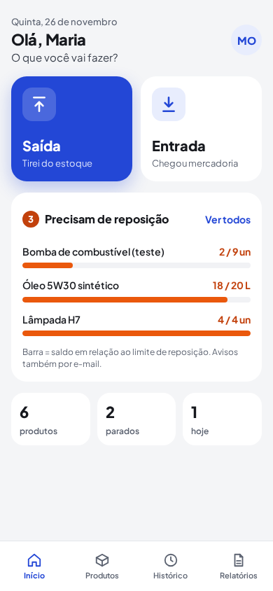
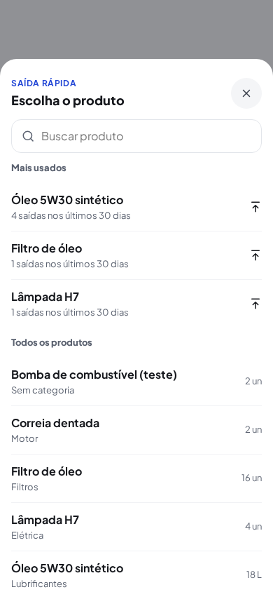
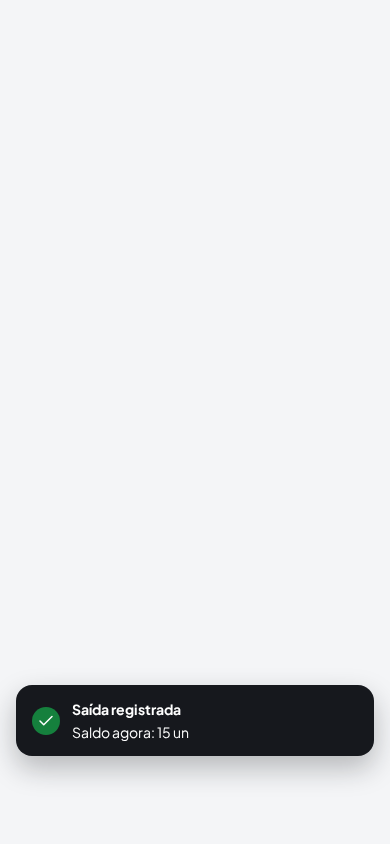
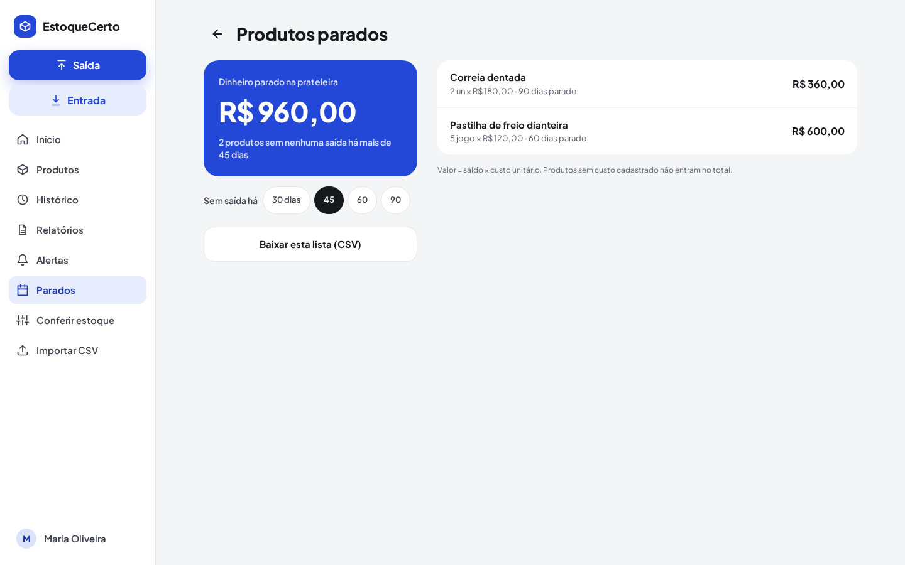
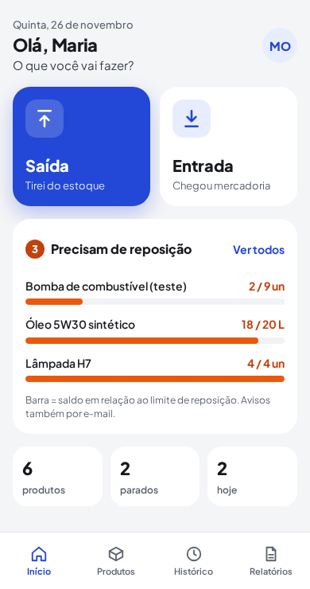
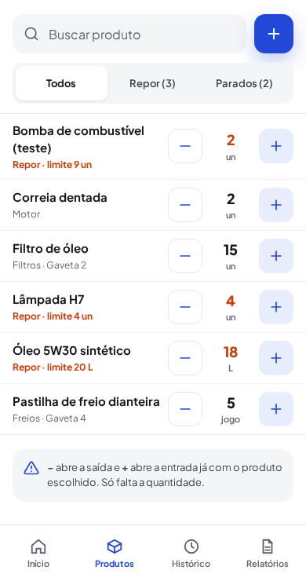
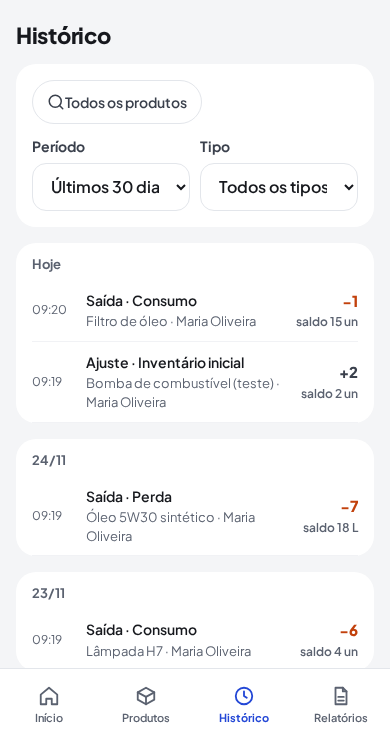
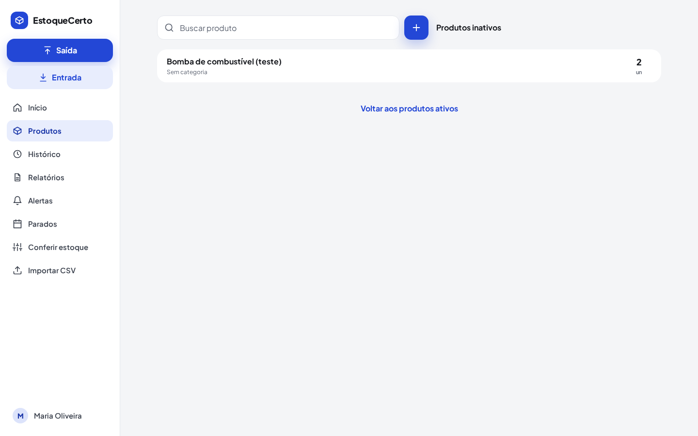

# Evidências de teste

Execução de 26/11/2026, em ambiente local (Postgres em Docker, Chromium sem tela). Corresponde à seção 14 e ao entregável "Evidências de teste" da seção 19 da documentação.

## Resumo

- Testes automáticos do back-end: **76 de 76 aprovados**.
- Testes no navegador: **25 de 25 aprovados**.

| Critério | Descrição | Resultado |
|---|---|---|
| 14 a | Saldo = entradas − saídas ± ajustes | Aprovado |
| 14 b | Saída maior que o saldo é recusada com mensagem clara | Aprovado |
| 14 c | Saída em até 3 interações a partir do painel | Aprovado |
| 14 d | Alerta gerado no limite e não duplicado | Aprovado |
| 14 e | Alerta encerrado quando a entrada eleva o saldo acima do limite | Aprovado |
| 14 f | Movimentações não podem ser editadas nem excluídas | Aprovado |
| 14 g | Produtos parados e valor imobilizado corretos | Aprovado |
| 14 h | CSV reflete o que a tela mostra | Aprovado |
| 14 i | Consultas em até 2 s com 500 produtos | Aprovado |
| 14 j | Utilizável no celular, sem rolagem horizontal | Aprovado |

## Evidência por critério

### a) Saldo = entradas − saídas ± ajustes

- Teste automático `test_saldo_e_soma_das_entradas_menos_saidas_e_ajustes`: aprovado
- Teste automático `test_ajuste_por_quantidade_contada_registra_variacao_com_sinal`: aprovado
- Teste automático `test_ajuste_por_variacao_positiva`: aprovado

### b) Saída maior que o saldo é recusada com mensagem clara

- Teste automático `test_saida_maior_que_o_saldo_e_recusada_com_mensagem_clara`: aprovado

### c) Saída em até 3 interações a partir do painel

- Navegador: 3 toques gravam a saída (saldo 16.0 → 15.0): aprovado

| Painel | 1º toque: Saída | 2º toque: produto | 3º toque: quantidade |
|---|---|---|---|
|  |  |  |  |

### d) Alerta gerado no limite e não duplicado

- Teste automático `test_alerta_dispara_quando_saldo_fica_exatamente_no_limite`: aprovado
- Teste automático `test_alerta_do_apendice_b_nao_duplica_e_encerra_ao_repor`: aprovado
- Teste automático `test_limite_usa_o_maior_entre_estoque_minimo_e_percentual`: aprovado

### e) Alerta encerrado quando a entrada eleva o saldo acima do limite

- Teste automático `test_alerta_do_apendice_b_nao_duplica_e_encerra_ao_repor`: aprovado

### f) Movimentações não podem ser editadas nem excluídas

- Teste automático `test_movimentacoes_nao_tem_rota_de_edicao_nem_exclusao`: aprovado
- Teste automático `test_trigger_do_banco_bloqueia_update_e_delete_direto`: aprovado
- Teste automático `test_produto_com_movimentacoes_nao_pode_ser_excluido`: aprovado

### g) Produtos parados e valor imobilizado corretos

- Teste automático `test_produtos_parados_e_valor_imobilizado`: aprovado
- Teste automático `test_periodo_de_parado_e_configuravel`: aprovado
- Navegador: Conta=45: tela abre em 45 dias: aprovado
- Navegador: Conta=45: quantidade igual à API (2): aprovado
- Navegador: Conta=90: tela abre em 90 dias: aprovado
- Navegador: Conta=90: quantidade igual à API (1): aprovado
- Navegador: Conta=30: tela abre em 30 dias: aprovado
- Navegador: Conta=30: quantidade igual à API (2): aprovado
- Navegador: troca manual de período continua funcionando: aprovado

### h) CSV reflete o que a tela mostra

- Teste automático `test_csv_de_estoque_bate_com_a_listagem_de_produtos`: aprovado
- Teste automático `test_csv_de_movimentacoes_bate_com_o_historico_da_tela`: aprovado
- Teste automático `test_csv_de_movimentacoes_filtra_por_tipo`: aprovado
- Teste automático `test_csv_de_parados_tem_linha_de_total`: aprovado

### i) Consultas em até 2 s com 500 produtos

- Teste automático `test_desempenho_com_500_produtos_e_movimentos`: aprovado

### j) Utilizável no celular, sem rolagem horizontal

- Navegador: 13 telas em 320px: aprovado
- Navegador: 13 telas em 360px: aprovado
- Navegador: 13 telas em 390px: aprovado

| Painel | Produtos | Histórico |
|---|---|---|
|  |  |  |

## Regras conferidas no navegador

### Produto inativo (RN09)

- produto abaixo do mínimo gera 1 alerta: aprovado
- inativado pela tela: aprovado
- alerta encerrado ao inativar: aprovado
- fora do relatório de reposição: aprovado
- fora do painel: aprovado
- editar produto inativo não cria alerta: aprovado

### Reativar produto

- inativo não aparece na lista normal: aprovado
- aparece em 'Ver produtos inativos': aprovado
- sem botões de saída/entrada no inativo: aprovado
- reativado pela tela: aprovado
- alerta volta ao reativar: aprovado
- volta para a lista normal: aprovado
- botão de inativos some sem inativos: aprovado

## Backup e restauração (RNF07)

`scripts/backup.sh` executado contra o banco de produção em 26/11/2026: gerou o dump, restaurou num PostgreSQL 17 temporário e as contagens ficaram iguais às da origem (1 usuário, 7 categorias, 8 produtos, 19 movimentações, 3 alertas, 1 configuração).

## O que não está coberto

- E-mail de alerta (RF09): desligado nesta fase, por decisão da equipe.
- Agendamento diário do backup: o GitHub Actions da conta não está iniciando os workflows.
- Desempenho em produção: o teste de 500 produtos roda localmente.
- Piloto e indicadores da seção 15: dependem do uso na oficina.
