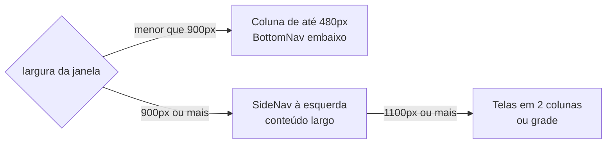
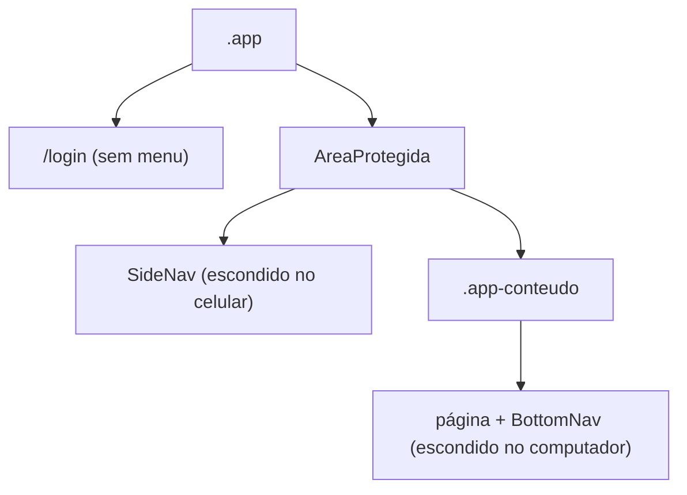

# Layout de celular e de computador

O app nasceu para o celular (design em `docs/design/`, telas de 390px). O layout de computador foi acrescentado **por cima**, sem alterar o de celular.

## A ideia: um só HTML, dois layouts



Não há detecção de aparelho em JavaScript nem componentes duplicados por tela. Quem decide é o CSS, por *media query*. Todo estilo de computador fica dentro de `@media (min-width: …)` no **fim** de cada arquivo CSS, e o que está fora dele continua valendo para o celular.

| Breakpoint | O que muda |
|---|---|
| `900px` | Menu lateral no lugar da barra de baixo; painéis de baixo viram janelas centralizadas; avisos vão para o canto direito |
| `1100px` | Duas colunas (a sidebar ocupa 248px, então antes disso sobra pouco espaço) |

## A casca



## O truque do `display: contents`

Para ter duas colunas é preciso agrupar elementos num `div`. Um `div` novo mudaria o espaçamento do celular, então ele nasce "invisível":

```css
.entrada-corpo { display: contents; }          /* celular: como se o div não existisse */

@media (min-width: 1100px) {
  .entrada-corpo { display: grid; grid-template-columns: 1fr 1fr; }
}
```

## Armadilha: ordem do CSS

`main.tsx` importa `styles.css` **depois** dos CSS das páginas. Com a mesma especificidade, o global vence. Por isso há seletores compostos como `.page.parados` ou `.historico .historico-filtros`: um `.parados { display: grid }` sozinho perderia para `.page { display: flex }`.

## Como conferir que o celular não mudou

Tire prints em 390px antes de mexer, tire de novo depois e compare pixel a pixel. Uma conferência "no olho" não pega diferenças de 1 ou 2 pixels. Nesta mudança, as 18 telas ficaram idênticas.

## Ao criar uma tela nova

1. Escreva o CSS de celular normalmente.
2. Acrescente o `@media (min-width: 900px)` no fim do arquivo.
3. Se a tela deve aparecer no menu lateral, inclua-a em `NAVEGACAO` (`components/SideNav.tsx`).
4. Confira em 390, 900, 1024 e 1440px.
